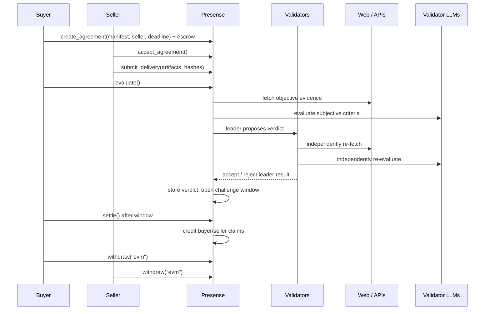

# Presense

**The sense check before settlement.**

Presense is a reusable GenLayer Intelligent Contract primitive that adjudicates whether agent-delivered work satisfies an agreed **Acceptance Manifest** (the Acceptance Test Manifest), then settles escrow according to a structured verdict.

> **Status:** Phases 0–5 are implemented. The contract supports manifest validation, objective and subjective evaluation, independent validator comparison, challenges, verdict payouts, settlement, and pull-payment withdrawal. Phase 6 hardening and live-network validation remain.

---

## Current verification

Run from the project root:

```bash
python -m venv .venv
.venv/Scripts/python -m pip install -r requirements.txt   # Windows
# source .venv/bin/activate && pip install -r requirements.txt  # macOS/Linux

genvm-lint check contracts/Presense.py
pytest tests/direct/ -v
```

Expected:

```text
✓ Lint passed (3 checks)
✓ Validation passed
  Contract: Presense
  Methods: 22 (12 view, 10 write)
131 passed
```

For coverage:

```bash
pytest tests/direct/ --cov=contracts --cov-report=term-missing
```

Run the command above for the current statement and branch coverage report.

`tests/conftest.py` carries two narrow shims for `genlayer-test 0.29.2`:
a fallback for GenVM's renamed runner bundle, and a Windows-safe temp-file
cleanup. They can be removed when the upstream toolchain handles both cases.

---

## Why Presense exists

The agentic economy is being built around payments (`x402`), identity (`ERC-8004`), and interoperability (`A2A`). Every layer assumes the happy path. None of them answers the question that appears the moment an agent delivers work:

> **Did the agent actually deliver what was agreed?**

Today the answer comes from one of three bad options:

1. A centralized platform judges the work.
2. A single LLM prompt decides, with no evidence model and no independent verification.
3. A human goes to court, months later, at a cost larger than the job.

Presense makes the acceptance decision a first-class, neutral, evidence-based primitive. A buyer and a seller freeze a machine-readable acceptance manifest before work begins. When the seller submits delivery, GenLayer validators independently evaluate the evidence and produce a structured verdict. Escrow is released, split, or refunded according to that verdict.

The name is a portmanteau of **pre** + **sense**: the sense check that happens **before** money settles.

---

## What Presense is not

- Not a generic “AI judges the work” wrapper.
- Not a prediction market, insurance product, or marketing verification platform.
- Not a replacement for a court or legal advice.
- Not a frontend that computes the answer and asks GenLayer to store it.
- Not a single-model oracle.

Presense is a **contract primitive**: other builders can integrate it into agent marketplaces, freelance escrow, grant programs, bounty platforms, and agent-to-agent commerce.

---

## Core flow



---

## The four artifacts

| Artifact                | Purpose                                                                                            |
| ----------------------- | -------------------------------------------------------------------------------------------------- |
| **Agreement**           | Binds buyer, seller, escrow, manifest, deadline, and challenge window.                             |
| **Acceptance Manifest** | Immutable JSON document containing objective checks and subjective rubrics.                        |
| **Submission**          | Seller’s delivered artifacts: URLs, hashes, notes, timestamp.                                      |
| **Verdict**             | Structured decision: `ACCEPT`, `PARTIAL`, `REJECT`, or `UNDETERMINED`, with per-criterion results. |

---

## Repository layout

```text
presense/
├── README.md
├── LICENSE
├── requirements.txt
├── pyproject.toml
├── .gitignore
├── gltest.config.yaml.example # integration network account template
├── docs/
│   ├── 00-product-brief.md
│   ├── 01-architecture.md
│   ├── 02-contract-spec.md
│   ├── 03-consensus-design.md
│   ├── 04-security-threat-model.md
│   ├── 05-testing-strategy.md
│   ├── 06-implementation-plan.md
│   ├── 07-deployment-runbook.md
│   ├── 08-portal-submission.md
│   ├── 09-roadmap-and-grants.md
│   └── 10-glossary-and-references.md
├── contracts/
│   └── Presense.py    # manifest, evaluation, challenge, and settlement
├── tests/
│   ├── conftest.py    # toolchain compatibility shims
│   ├── direct/
│   │   ├── test_manifest.py
│   │   ├── test_lifecycle.py
│   │   ├── test_checks_objective.py
│   │   ├── test_checks_subjective.py
│   │   ├── test_settlement.py
│   │   └── test_smoke.py
│   └── integration/   # live-network tests
├── deploy/            # deployment scripts (planned)
└── examples/          # manifests and payloads (planned)
```

---

## Documentation index

| Document                                                         | Read it for                                                      |
| ---------------------------------------------------------------- | ---------------------------------------------------------------- |
| [00 — Product Brief](docs/00-product-brief.md)                   | Problem, users, scope, success metrics, positioning.             |
| [01 — Architecture](docs/01-architecture.md)                     | System context, flows, state machine, trust boundaries.          |
| [02 — Contract Spec](docs/02-contract-spec.md)                   | Exact API, data model, manifest schema, payouts, errors.         |
| [03 — Consensus Design](docs/03-consensus-design.md)             | Leader/validator logic, equivalence rules, prompt design.        |
| [04 — Security & Threat Model](docs/04-security-threat-model.md) | Prompt injection, evidence poisoning, collusion, residual risks. |
| [05 — Testing Strategy](docs/05-testing-strategy.md)             | Direct mode, mocks, adversarial tests, integration tests.        |
| [06 — Implementation Plan](docs/06-implementation-plan.md)       | Phases, tasks, deliverables, definition of done.                 |
| [07 — Deployment Runbook](docs/07-deployment-runbook.md)         | Local setup, Studio, Bradbury, deploy, verify, troubleshoot.     |
| [08 — Portal Submission](docs/08-portal-submission.md)           | Evidence checklist and reviewer-facing narrative.                |
| [09 — Roadmap & Grants](docs/09-roadmap-and-grants.md)           | v1.1, project path, integrations, grant milestones.              |
| [10 — Glossary & References](docs/10-glossary-and-references.md) | Terms and canonical links.                                       |

**Recommended reading order:** [00](docs/00-product-brief.md) → [01](docs/01-architecture.md) → [02](docs/02-contract-spec.md) → [03](docs/03-consensus-design.md) → [05](docs/05-testing-strategy.md) → [06](docs/06-implementation-plan.md) → [07](docs/07-deployment-runbook.md) → [08](docs/08-portal-submission.md). Read [04](docs/04-security-threat-model.md) before hardening and [09](docs/09-roadmap-and-grants.md) when planning the next version.

---

## Design principles

1. **Evidence first, judgment second.** Deterministic checks run before any LLM call.
2. **The manifest is the contract.** If it is not in the manifest, it is not a criterion.
3. **The validator must independently verify.** A schema-valid lie must fail.
4. **Only decision fields are compared.** Reasoning text may differ; `passed`, `score`, and `decision` must not.
5. **No admin keys.** No pause, no upgrade proxy, no privileged operator.
6. **Pull payments.** Settlement credits claims; recipients withdraw. No automatic push that can silently fail.
7. **Fail closed.** Missing or unverifiable evidence produces `UNDETERMINED`, not a guessed verdict.
8. **Small v1.** Five check types, one buyer, one seller, one escrow, one challenge.
9. **Public evidence only.** Do not put secrets in manifests or URLs.
10. **Build to be reused.** The contract is a primitive, not a product demo.

---

## v1 scope

- One buyer and one seller.
- Native GEN escrow.
- On-chain Acceptance Manifest (JSON, max 16 KiB).
- Objective checks: `http_status`, `json_has_keys`, `file_hash`, `text_contains`.
- Subjective checks: `llm_rubric` with evidence-quote verification.
- One challenge per agreement, with counter-evidence and re-evaluation.
- Pull-payment claims and withdrawal.
- Expiry refund if the seller does not submit by the deadline.

## Out of scope for v1

- Multiple milestones or tranches.
- Multi-party agreements.
- Challenge bonds and slashing.
- Private/encrypted evidence.
- Fiat or ERC-20 escrow.
- Automatic appeal integration with the GenLayer protocol.
- A hosted frontend.

These are sequenced in [09 — Roadmap & Grants](docs/09-roadmap-and-grants.md).

---

## Quickstart

```bash
# 1. Install (use the project virtual environment)
python -m venv .venv
pip install -r requirements.txt

# 2. Lint and validate
genvm-lint check contracts/Presense.py

# 3. Fast tests (runs today)
pytest tests/direct/ -v

# 4. Local integration (requires a running GenLayer node)
gltest tests/integration/ -v -s --network localnet

# 5. Deploy to Bradbury (once the interface stabilizes)
genlayer network set testnet-bradbury
genlayer deploy --contract contracts/Presense.py
```

> Steps 2 and 3 are runnable without a network. Step 4 requires a running local
> GenLayer node; see the [integration test notes](tests/integration/README.md).
> Step 5 requires a configured deployment network and a stabilized interface.
>
> On Windows, prefix `genvm-lint` with `$env:PYTHONIOENCODING="utf-8"` if the
> CLI fails while printing Unicode output.

---

## License

MIT. See [`LICENSE`](LICENSE).

---

## Contributing

This is a solo-builder project during v0.1. The documentation is intentionally detailed so that another builder can review, fork, or continue the work without context loss.

Before changing the contract, update:

1. The relevant spec document.
2. The test matrix.
3. The deployment runbook if the interface changes.
4. The portal submission narrative if the consensus design changes.
