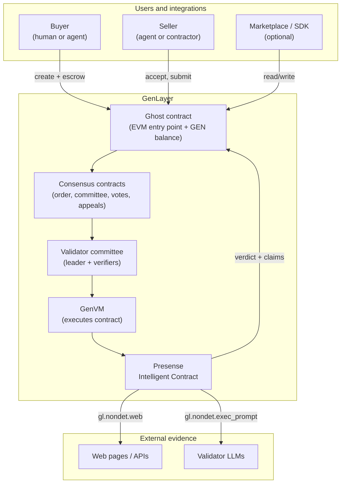
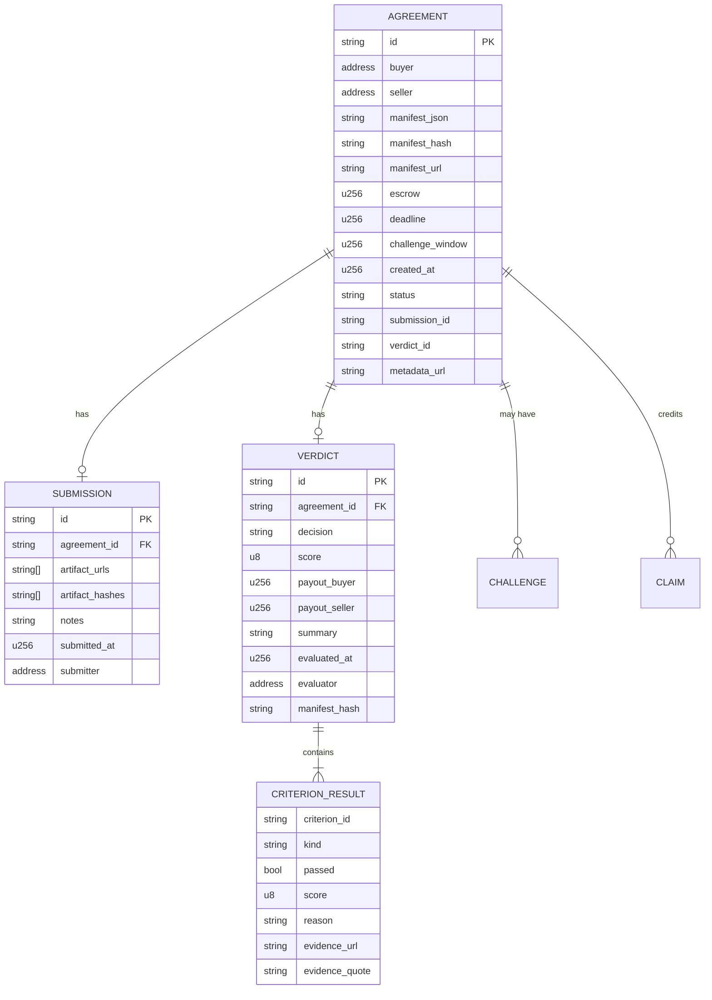
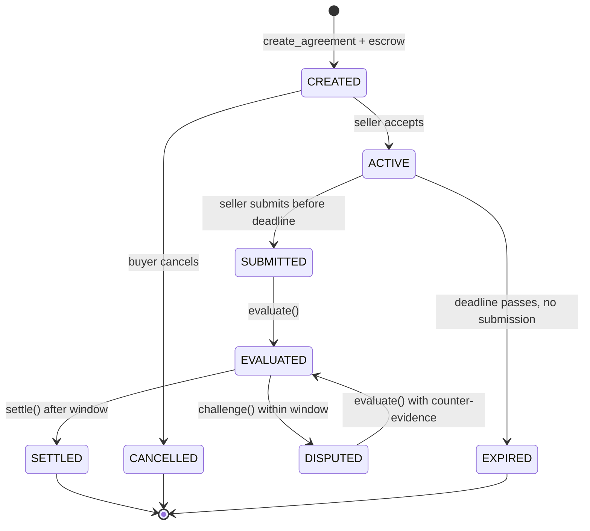
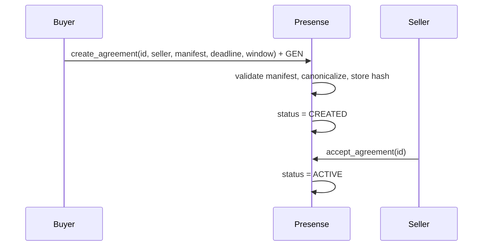
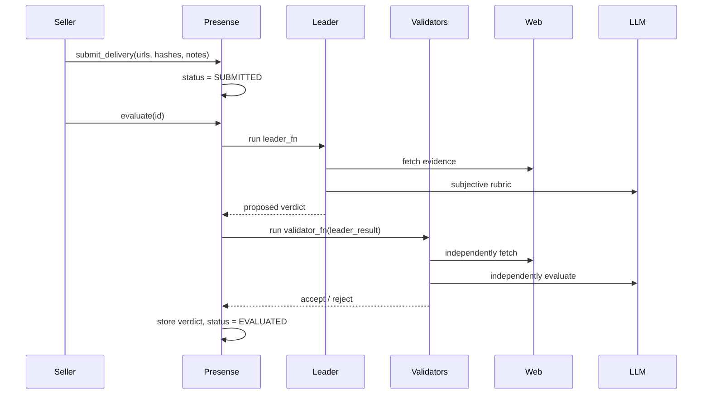
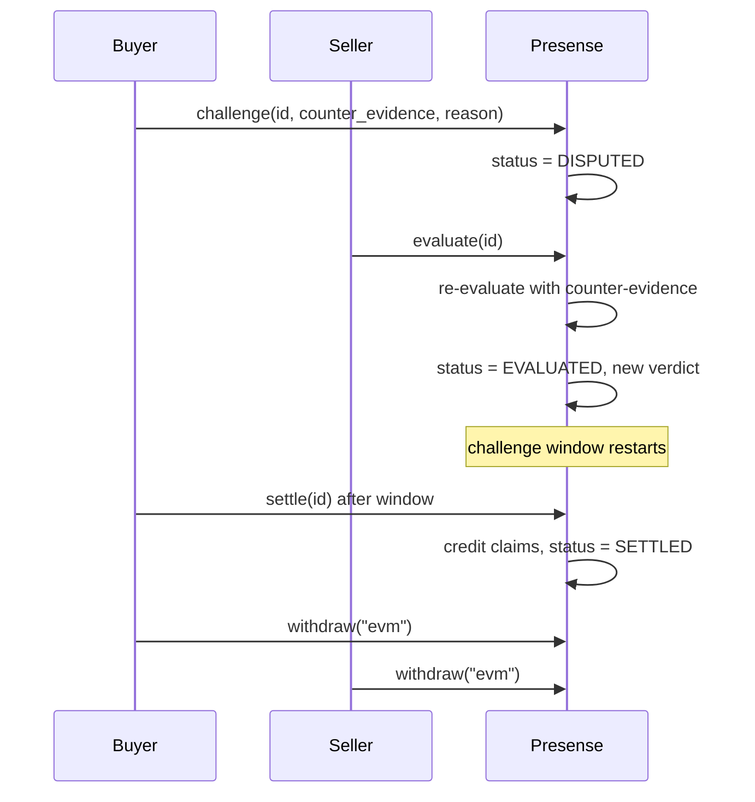
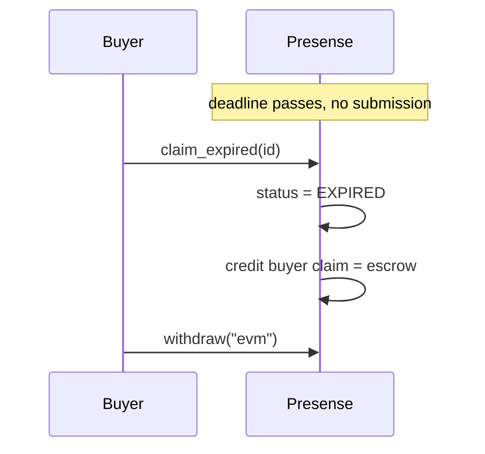
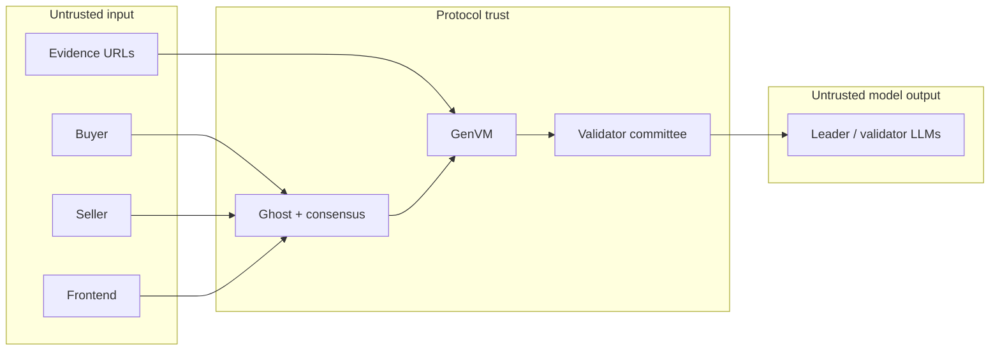

# 01 — Architecture

**Project:** Presense
**Version:** 0.1
**Purpose:** Define the system context, components, data flow, state machine, and trust boundaries.

---

## 1. System context

Presense is a single Intelligent Contract deployed on GenLayer, plus optional clients that create agreements and display verdicts.



### Key point

The GenLayer Chain (EVM layer) records transaction order, committee assignments, votes, appeals, and final outcomes. The Intelligent Contract executes in GenVM. The ghost contract holds the contract’s GEN balance and relays calls. Presense stores all agreement state in the Intelligent Contract; the ghost is the value and entry-point layer.

---

## 2. Components

| Component | Responsibility | Trust level |
|---|---|---|
| **Buyer** | Creates agreement, funds escrow, can challenge. | Untrusted; economically bound by escrow. |
| **Seller** | Accepts agreement, submits delivery, can challenge. | Untrusted; economically bound by escrow. |
| **Presense contract** | Stores agreements, manifests, submissions, verdicts, claims; enforces lifecycle; runs checks. | Deterministic code, publicly verifiable. |
| **GenVM** | Sandboxed execution; separates deterministic and non-deterministic calls. | Protocol trust. |
| **Validator committee** | Leader proposes verdict; validators independently verify. | Economically incentivized; diverse models. |
| **Ghost contract** | Holds GEN; relays transactions; executes external messages on finalization. | Protocol trust. |
| **Web/API sources** | Evidence for objective checks. | Untrusted; verified by hash/quote. |
| **Validator LLMs** | Judgment for subjective criteria. | Untrusted individually; trusted as a diverse panel. |
| **Frontend/SDK** | UX, manifest generation, indexing, display. | Untrusted; never computes the authoritative verdict. |

---

## 3. On-chain vs off-chain responsibilities

| Concern | Where it belongs |
|---|---|
| Manifest authoring | Off-chain (buyer’s editor/template), then frozen on-chain. |
| Manifest storage | On-chain, canonical JSON, max 16 KiB. |
| Manifest hash | On-chain. |
| Evidence storage | Off-chain (URLs); hashes on-chain. |
| Evidence fetching | Inside the non-deterministic block, by leader and validators. |
| Objective checks | Contract code, deterministic given fetched bytes. |
| Subjective checks | LLM call inside non-deterministic block, with validator re-run. |
| Verdict storage | On-chain, structured. |
| Escrow accounting | On-chain. |
| Payout execution | Pull claims + `withdraw`. |
| UX, notifications, indexing | Off-chain. |
| Dispute escalation to protocol appeals | GenLayer protocol, not the contract. |

**Rule:** the frontend may prepare evidence URLs and display results, but it must never be the sole evaluator. If the frontend computes the verdict and Presense only stores it, the design fails the GenLayer fit test.

---

## 4. Data model overview



---

## 5. State machine



### States

| State | Meaning | Allowed actions |
|---|---|---|
| `CREATED` | Buyer funded escrow; seller has not accepted. | `accept_agreement`, `cancel_agreement`, `claim_expired` (after acceptance deadline, if defined). |
| `ACTIVE` | Seller accepted; work in progress. | `submit_delivery`, `claim_expired` after deadline. |
| `SUBMITTED` | Seller submitted delivery. | `evaluate`. |
| `EVALUATED` | Verdict stored; challenge window open. | `challenge` (within window), `settle` (after window). |
| `DISPUTED` | Counter-evidence submitted. | `evaluate` (re-evaluation). |
| `SETTLED` | Claims credited. | `withdraw`. |
| `CANCELLED` | Buyer cancelled before seller accepted. | `withdraw` (buyer refund). |
| `EXPIRED` | Deadline passed without submission. | `withdraw` (buyer refund). |

### Off-chain UX state

`UNDER_REVIEW` is an **off-chain** state used by indexers/frontends while an `evaluate` transaction is pending. It is not stored on-chain because the verdict is produced inside the same transaction.

### `UNDETERMINED`

`UNDETERMINED` is a **verdict value**, not an agreement state. When evaluation cannot reach a reliable result, the contract raises a user error and does not store a verdict. The agreement remains `SUBMITTED` (or `DISPUTED`), and evaluation can be retried. This avoids locking in a bad state.

---

## 6. End-to-end flows

### 6.1 Create and accept



**Design notes:**

- The buyer is `gl.message.sender_address`; the seller is an explicit parameter.
- The manifest is canonicalized with `json.dumps(obj, sort_keys=True, separators=(",", ":"))`.
- The stored `manifest_json` is the canonical string, so `sha256(manifest_json)` always matches `manifest_hash`.
- Escrow must equal `gl.message.value` and be greater than zero.

### 6.2 Submit and evaluate



**Design notes:**

- `evaluate` is callable by anyone. The parties are incentivized to trigger it; a third party can help.
- The leader and validators fetch the same URLs. The manifest’s `evidence_policy` restricts domains and sizes.
- Objective checks are deterministic given the fetched bytes. Subjective checks use the LLM.
- The accepted leader result is what gets stored. Validators verify or reject it.

### 6.3 Challenge and settle



**Design notes:**

- v1 allows one challenge per agreement.
- A challenge is an **evidence challenge**, not a GenLayer protocol appeal. Protocol appeals are handled by GenLayer’s consensus layer automatically.
- `settle` is callable by anyone after the challenge window. It does not depend on a party’s cooperation.
- Settlement credits claims; it does not push funds. This avoids failed-message loss and lets the recipient declare whether they are an EVM address or an Intelligent Contract.

### 6.4 Expiry



---

## 7. Trust boundaries



### Boundary rules

1. **Never trust the buyer’s or seller’s claim.** Verify against the manifest and evidence.
2. **Never trust a single URL.** Use hashes, allowed domains, and multiple sources where possible.
3. **Never trust the leader’s output.** Validators independently re-run.
4. **Never trust a single LLM.** Greyboxing and validator diversity are the defense.
5. **Never trust the frontend’s verdict.** The contract is the source of truth.
6. **Never trust the manifest URL.** The manifest is stored on-chain and hash-checked.

---

## 8. Why the manifest is on-chain

Alternatives considered:

| Option | Problem |
|---|---|
| Store only a URL | The URL can change, go offline, or serve different content to different validators. |
| Store only a hash | Validators cannot evaluate without the content; an off-chain fetch becomes a trust anchor. |
| Store full manifest on-chain | Higher storage cost, but immutable and universally available. |

**Decision:** store the canonical manifest JSON on-chain, with a 16 KiB cap. Store an optional `manifest_url` for human readability. The hash is derived from the stored canonical JSON, so it is always consistent.

This is the single most important design choice for verifiability. A dispute about “what was agreed” must never depend on an off-chain document that can change.

---

## 9. Why pull payments

Alternatives:

| Option | Problem |
|---|---|
| Push GEN automatically on `settle` | The contract must know whether the recipient is an EOA/EVM contract or an Intelligent Contract, and a failed message may not return value. |
| Push via a keeper | Introduces an operator and a liveness dependency. |
| Pull claims + `withdraw(kind)` | The recipient declares their kind; they pay the withdrawal gas; no operator; no routing guess. |

**Decision:** `settle` credits `claims[address]`. `withdraw(kind)` sends the caller’s claim. `kind` is `"evm"` for EOAs and EVM contracts, `"ic"` for Intelligent Contracts. The contract uses:

```python
if kind == "ic":
    gl.get_contract_at(recipient).emit_transfer(value=amount, on="finalized")
else:
    _Recipient(recipient).emit_transfer(value=amount)
```

`_Recipient` is an EVM contract interface declared at the top of the contract:

```python
@gl.evm.contract_interface
class _Recipient:
    class View:
        pass
    class Write:
        pass
```

**Residual risk:** if the emitted message fails on the destination, the value may not return automatically. The contract keeps the claim accounting simple and documents this as a known GenLayer message risk. Recipients should test with a small amount first.

---

## 10. Deployment topology

| Environment | Purpose | Persistence | Use in this project |
|---|---|---|---|
| **Studio** | Browser IDE, zero setup. | Temporary. | First contract experiments, UI debugging. |
| **GLSim** | Local JSON-RPC simulator, ~1s startup. | Local. | Fast integration tests without Docker. |
| **Localnet** | Full GenVM + validators via Docker. | Local. | Consensus and multi-validator testing. |
| **Studionet** | Hosted stable dev. | Temporary. | Pre-Bradbury integration checks. |
| **Bradbury** | Production-like testnet with real AI workloads. | Persistent. | Final validation and portal evidence. |

**Recommended path:** Studio → GLSim → Localnet → Studionet → Bradbury.

---

## 11. Failure modes and behavior

| Failure | Contract behavior | User-visible result |
|---|---|---|
| Manifest invalid | Revert with `E_MANIFEST_INVALID`. | Agreement not created; escrow not accepted. |
| Escrow zero | Revert with `E_ESCROW_ZERO`. | Agreement not created. |
| Seller never accepts | Buyer can cancel; escrow refunded. | `CANCELLED`, buyer claim. |
| Seller misses deadline | Anyone can expire; buyer refunded. | `EXPIRED`, buyer claim. |
| Evidence URL offline | Criterion fails or evaluation returns `UNDETERMINED`. | Retry or reject per manifest policy. |
| Evidence domain not allowed | Revert with `E_EVIDENCE_DOMAIN`. | Submission rejected. |
| LLM returns malformed JSON | Validator disagrees; transaction retries with a new leader. | Eventually `UNDETERMINED` if persistent. |
| Leader returns schema-valid lie | Validator re-runs and rejects. | New leader or `UNDETERMINED`. |
| Validators disagree on subjective score | Tolerance ±1; if still split, retry. | `UNDETERMINED` rather than a random verdict. |
| Challenge window passes | `settle` credits claims. | `SETTLED`. |
| Withdraw message fails | Value may not return automatically. | Documented residual risk; test with small amounts. |
| Contract balance < claims | Internal invariant violation; settlement should never allow it. | Tests enforce conservation. |

---

## 12. Architectural invariants

1. `manifest_hash == sha256(manifest_json)` for every stored agreement.
2. `escrow > 0` for every funded agreement.
3. `payout_buyer + payout_seller == escrow` for every verdict.
4. `sum(claims) + unclaimed == total_locked` at all times.
5. A verdict has exactly one result per manifest criterion, in the same order.
6. A criterion result’s `criterion_id` exists in the manifest.
7. `SETTLED`, `CANCELLED`, and `EXPIRED` are terminal for their agreement.
8. No address can withdraw more than its claim.
9. No one can change a stored manifest.
10. No admin can pause, upgrade, or override the contract.

These invariants are enforced in code and tested in [05 — Testing Strategy](05-testing-strategy.md).

---

## 13. Next document

Read [02 — Contract Spec](02-contract-spec.md) for the exact API, data types, manifest schema, and payout rules.
